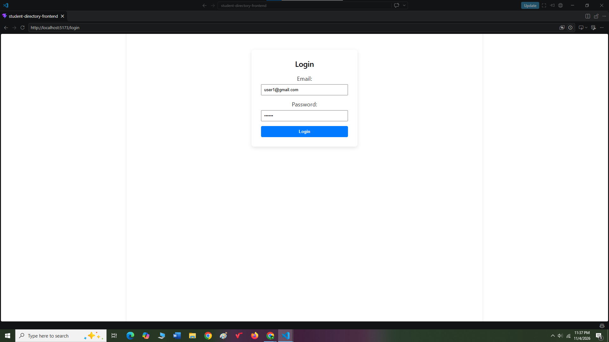
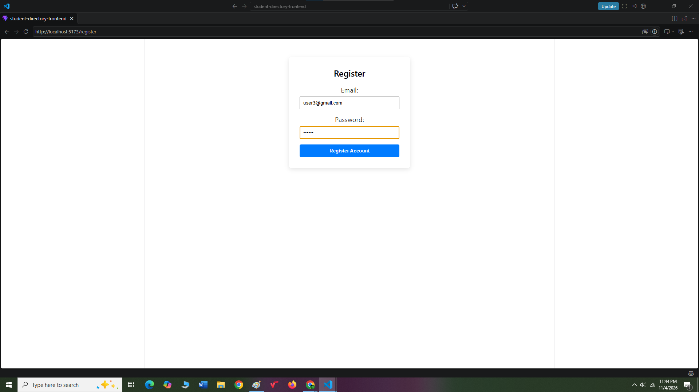
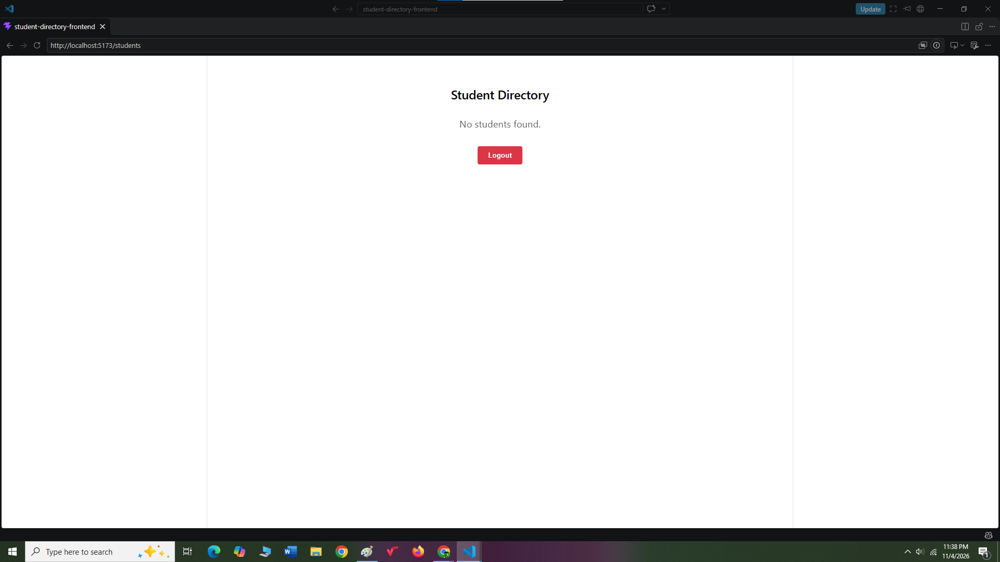
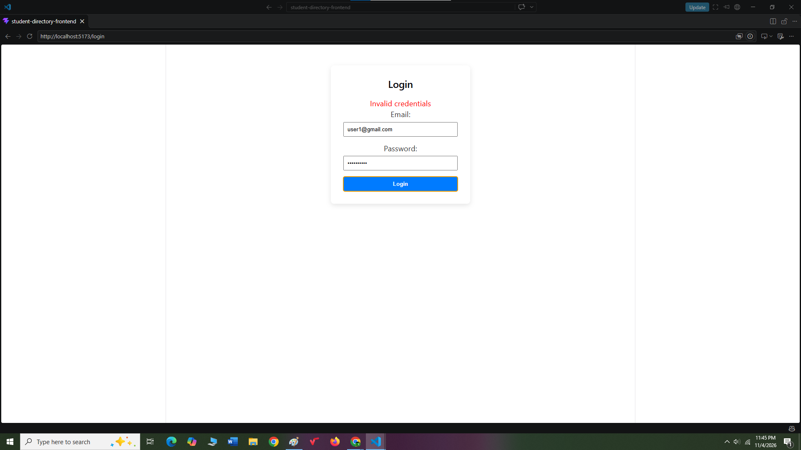
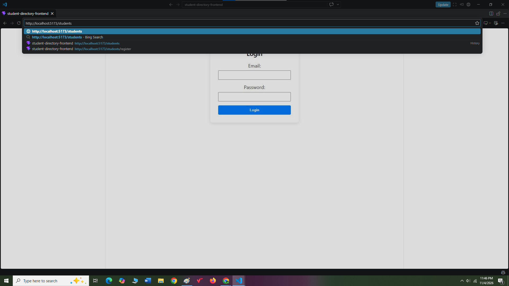
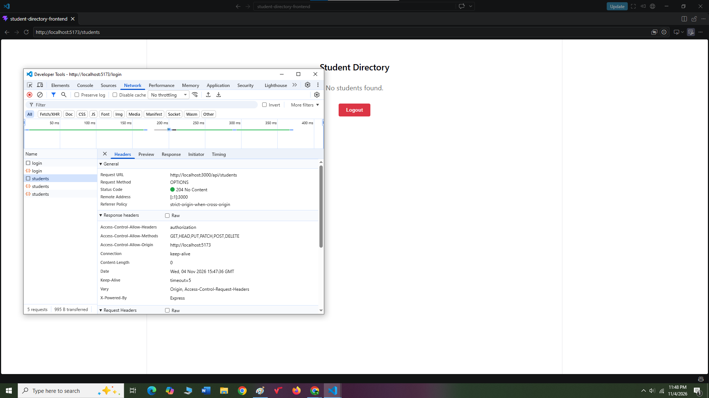

# Student Directory Frontend

React frontend for student management and authentication.

## Setup
```bash
npm install
npm run dev
```

---

## Reflection Questions

### 1. Token Storage & Security
We store the JWT in `localStorage` to keep the user logged in across page refreshes and browser tabs. However, `localStorage` is vulnerable to Cross-Site Scripting (XSS) attacks where malicious scripts can steal the token. A more secure alternative is using `httpOnly` cookies, which prevent JavaScript access entirely.

### 2. Purpose of AuthContext
`AuthContext` globally manages the authentication state and token across the app without manual prop drilling. Passing the token as a prop to every component leads to bloated, hard-to-maintain code through multiple UI layers. Context allows any nested component to access auth data directly using the `useAuth` hook.

### 3. JWT Expiration Handling
When a JWT expires, backend requests fail with a `401 Unauthorized` status error. The best user experience catches this error, clears invalid tokens from storage, and resets the auth context state. The app should then show a brief "Session Expired" alert and redirect the user directly to `/login`.

### 4. Backend vs. Frontend Route Protection
The backend's `requireAuth` middleware cryptographically protects database endpoints, while `ProtectedRoute` only controls UI page access. Client-side protection is easily bypassed by inspecting code, whereas server-side middleware guarantees true security. We need both to provide a seamless user interface while ensuring API data remains fully locked down.

---

## Screenshots

### 1. Login Page


### 2. Register Page


### 3. Successful Login


### 4. Failed Login Error


### 5. Protected Route Redirect


### 6. DevTools Network Header
